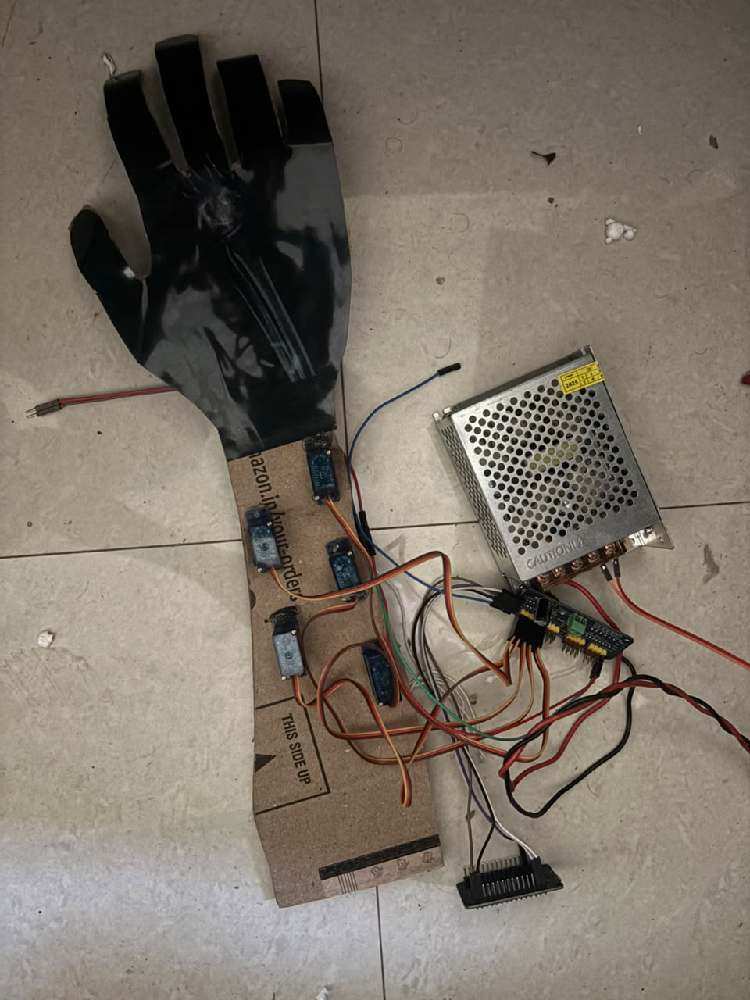

# Robotic Palm

**A five-finger, tendon-driven robotic hand controlled from any web browser — no app, no computer, no cloud.**

An ESP32 hosts the control page itself. You connect to it over Wi-Fi, open a link, and the hand
performs twelve static signs and five animated gestures. Built as a first-year B.Tech Electrical
Engineering project at BIET Jhansi.

<p align="center">
  
</p>

---

## What it does

- **12 static hand signs** — open, fist, peace, point, thumbs-up, rock, OK, call-me, gun, three, four, middle
- **5 animated gestures** — wave (travelling, little finger to thumb), hello, count 5→0, grab, drum
- **Per-finger control in degrees**, with a live position readout
- **In-browser calibration** — set each finger's open and closed endpoints and save them to flash
- **Three ways to reach it** — assigned IP, `hand.local` (mDNS), or the board's own access point at
  `192.168.4.1`, which works with no router present

Everything is served from the ESP32's flash. There is nothing to install on the phone.

---

## How it works

```
 Browser  ──HTTP──▶  ESP32  ──I²C──▶  PCA9685  ──PWM──▶  5 × SG90  ──tendon──▶  Fingers
                   web server       16-ch driver        50 Hz            nylon line
                   motion engine    addr 0x40      500–2400 µs
```

Each finger is pulled closed by a nylon tendon wound on a servo horn, exactly as the forearm
muscles operate a human hand. The fingers reopen through the elastic recovery of the palm
material, which halves the number of actuators needed.

The ESP32 does not generate the servo pulses. It writes values over I²C to a PCA9685, which
reproduces the pulses in hardware — so servo timing is completely unaffected by web traffic.

---

## Engineering highlights

### Synchronised motion

Fingers have very different travels — the thumb closes at 110° while the middle finger needs 175°.
Stepping them all at the same rate makes the hand close raggedly. Instead each finger's step is
scaled by its share of the longest remaining distance:

```c
float step = speed * (fabs(diff) / maxDiff);
```

A finger that must travel twice as far moves twice as fast, so all five arrive together.
Measured, with travels differing by 65°:

```
          THUMB  INDEX  MIDDLE  RING   PINKY
t+0.0 s      16     14      16     16      16
t+1.6 s      59     14      89     89      87
t+3.7 s     109     14     174    174     169   ← all arrive together
```

### Signs stored as percentages, not angles

```c
const int G_FIST[5] = { 100, 100, 100, 100, 100 };   // 0 = open, 100 = closed
```

Each percentage is converted using that finger's own calibrated endpoints. One definition of
"fist" therefore produces the correct travel on all five fingers — and recalibrating a finger
automatically corrects every gesture that uses it, with no code change.

### Protecting an actuator that cannot complain

A hobby servo cannot report whether it reached its target. If a tendon blocks it, the motor keeps
drawing ~700 mA stall current, overheats and strips its gears. Three layers guard against this:

1. **Per-finger travel limits** in the finger table
2. **Clamping** of every computed value before it reaches the driver
3. **Automatic relax** — PWM is removed 8 seconds after motion stops, so an idle hand draws nothing

### Non-blocking firmware

No `delay()` anywhere. The main loop serves HTTP, reads the serial console and advances the
motion engine on a `millis()`-based 20 ms tick, so nothing ever stalls anything else.

---

## Measured results

Verified at the register level rather than by eye:

| Measurement | Result |
|---|---|
| PWM frequency | **49.9 Hz** against a 50 Hz target |
| Pulse accuracy | within **one count (4.89 µs)** of commanded, on every channel |
| Repeatability | 6 open–close cycles, 12 register readings, **all identical** |
| Channel isolation | each finger moves alone; no cross-talk |
| Calibration persistence | survives a power cycle intact |

The repeatability test turned out to be the most useful diagnostic in the project: because the
control signal is provably identical every time, any variation seen in a finger must come from
the mechanism, not the software.

---

## Hardware

| Component | Detail |
|---|---|
| Controller | ESP32 DevKit V1 (ESP-WROOM-32) |
| Servo driver | PCA9685, 16-channel, I²C address `0x40` |
| Actuators | 5 × SG90 micro servo, ~1.8 kg·cm |
| Servo power | 5 V 5 A SMPS (separate rail) |
| Controller power | 5 V USB |
| Mechanism | Nylon tendon lines, moulded five-finger palm |

### Wiring

| ESP32 | → | PCA9685 |
|---|---|---|
| `3V3` | → | `VCC` |
| `GND` | → | `GND` — **common ground is mandatory** |
| `GPIO22` | → | `SDA` |
| `GPIO23` | → | `SCL` |

| Channel | `CH0` | `CH1` | `CH2` | `CH3` | `CH4` |
|---|---|---|---|---|---|
| **Finger** | THUMB | INDEX | MIDDLE | RING | PINKY |
| **Open** | 15° | 15° | 15° | 15° | 15° |
| **Closed** | 110° | 140° | 175° | 175° | 170° |

> The servo supply is kept separate from the controller supply — five servos can momentarily draw
> ~3.5 A, far beyond what the ESP32's regulator can deliver. The two share only the ground
> reference.

Full assembly reference, including tendon routing and troubleshooting: **[WIRING.md](WIRING.md)**

---

## Getting started

```bash
git clone https://github.com/<your-user>/robotic-palm.git
cd robotic-palm

# optional: add your Wi-Fi so the hand joins your network
cp include/secrets.example.h include/secrets.h
#   then edit include/secrets.h

pio run -e palm -t upload
pio run -e palm -t monitor      # 115200 baud
```

**`secrets.h` is optional.** Without it the ESP32 skips the router entirely and brings up its own
access point — join `RoboticHand` (password `hand12345`) and open `http://192.168.4.1`.

On boot the serial console prints every address the hand is reachable at.

### Serial commands

| Command | Action |
|---|---|
| `deg <0-4> <0-180>` | Move one finger to an absolute angle |
| `sign <name>` / `seq <name>` | Run a static sign or an animated gesture |
| `table` | Print the active calibration |
| `reg` | Read back the PCA9685 configuration and output registers |
| `net` | Link status, all addresses, signal strength, free heap |
| `save` / `load` / `defaults` | Write, reload or reset stored calibration |
| `r` | Relax — remove PWM from all channels |

---

## Documentation

| File | Contents |
|---|---|
| **[Robotic_Palm_Report.pdf](Robotic_Palm_Report.pdf)** | Full 18-page project report — design, calibration data, test results |
| **[WIRING.md](WIRING.md)** | Complete assembly and reassembly reference |
| **[DEVLOG.md](DEVLOG.md)** | Phase-by-phase build log kept during development |

---

## Known limitations

- **No position feedback** — a slipped tendon cannot be detected; all safety is preventive
- **No grip force control** — this needs current sensing or fingertip force sensors
- **Tight margin on two fingers** — the middle and ring fingers close only 5° short of the servo's
  mechanical stop, so tendon stretch cannot be absorbed. A longer horn (15 mm → 30 mm) would
  restore the margin
- **One actuator per finger** — each finger curls as a unit; individual joints are not controlled
- **Modest payload** — SG90 torque limits the hand to light objects

## Possible next steps

Current sensing for force feedback · antagonistic tendons for a powered opening stroke ·
EMG control from forearm muscle signals · a wrist joint on one of the eleven free channels ·
over-the-air firmware updates

---

## Built by

Rudra Pratap Singh · Harshit Yadav · Ankit Kumar Yadav · Suchir Ram Mishra

B.Tech Electrical Engineering, Bundelkhand Institute of Engineering and Technology, Jhansi
Supervised by Er. Shailendra Gautam

## License

MIT — see [LICENSE](LICENSE).
